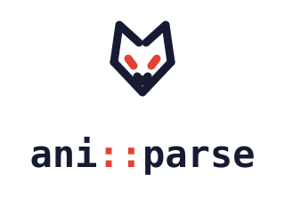

<div align="center">

<picture>
  <source media="(prefers-color-scheme: dark)" srcset="assets/lockup-dark.svg">
  
</picture>

**A common asynchronous C++20 API for anime, manga and image sources**


[](https://github.com/AnAgTeam/aniparse/actions/workflows/coverage.yml)
[](https://codecov.io/gh/AnAgTeam/aniparse)

**English** · [Русский](README.ru.md)

</div>

> [!WARNING]
> The library is in an early stage of development; the API may change substantially.

---

## What is AniParse?

**AniParse is a C++20 library with a common asynchronous API for anime, manga
and image sources.** It gives reader, media-browser and catalog applications a
shared way to search sources, load metadata, open chapter pages or resolve video
sources, according to what each source supports.

An application works with catalogs, profiles and getters; each source implementation
translates those operations into its own HTTP requests and HTML or JSON parsing.
The core provides the interfaces, value models, request execution and reusable
parsing tools. It builds as a static library by default, with an optional shared build.

### Core and source implementations

This repository contains the **library**, reusable engines and runnable examples.
Concrete sources are connected separately. [aniparse-parsers](https://github.com/AnAgTeam/aniparse-parsers)
provides implementations including AniList and Kitsu, which serve metadata rather
than chapter images or video. Linking the core alone does not register those sources.
Applications select which implementations to compile and register.

**Contents**

- [What is AniParse?](#what-is-aniparse)
- [What you can build with it](#what-you-can-build-with-it)
- [First steps](#first-steps)
- [Learn the API](#learn-the-api)
- [Requirements](#requirements)
- [Building](#building)
- [Installation](#installation)
- [Examples](#examples)
- [Embedded parser artwork](#embedded-parser-artwork)
- [Project structure](#project-structure)
- [Contributing](#contributing)
- [License](#license)

## What you can build with it

- **Browse and search catalogs.** Typed filter descriptions, sorting, autocomplete
  and item-offset pagination. Manga and anime catalogs can be separate or mixed;
  a card owns a manga getter, an anime getter, or both when the source groups them.
- **Load work data and media.** Titles, covers, publication information, chapters
  and pages, episodes and video sources, plus optional comments, ratings,
  related works and recommendations. Availability depends on the source.
- **Route links and restore saved works.** Resolve URLs to their parser and catalog;
  serialize getter identity for later restoration. Opaque IDs, external identities
  and cross-media relations let consumers preserve the distinctions between works.
- **Keep request profiles and accounts separate.** Catalogs select profiles for
  defaults, mirrors and authentication. Multiple catalogs may share a profile;
  the consumer explicitly chooses which authenticated context to use.
- **Choose the HTTP backend.** Curl and Apple NSURLSession implement the same
  `HttpClient` interface. Cancellable coroutine operations return `Result<T>`
  errors; HTML/DOM, CSS selectors and JSON helpers support source implementations.
- **Apply signed source settings.** `SourceOverrides` can replace declared domains,
  profile origins, selectors and patterns without replacing compiled parser code.
  Protocol or parsing-logic changes still require an implementation update.

Capability metadata helps consumers choose available actions; callers must still
handle `NotImplemented` and request failures. The library carries external IDs
and relations; decisions about matching or merging records belong to the consumer.
Future work and current boundaries are tracked in [docs/TODO.md](docs/TODO.md).

## First steps

**To use existing sources in an application**, start with
[aniparse-parsers](https://github.com/AnAgTeam/aniparse-parsers) and its
[live example](https://github.com/AnAgTeam/aniparse-parsers/blob/nightly/examples/example.cpp).
Select a catalog, create its profile context, then search and load the returned getters.

This fragment runs inside a `RequestTask` coroutine. `parser` is an owning handle
to a registered source, `catalog_id` comes from its `catalogs()` list, and `client`
is your HTTP backend. It prints listing previews and loads the first manga's
full description. Include `Parser.hpp` from `aniparse/source/`,
`CatalogRootGetter.hpp` from `aniparse/catalog/`, and `<iostream>`.

```cpp
auto root = parser->make_catalog_getter(catalog_id);
if (!root) {
    co_return make_request_error(RequestErrorCode::InvalidArguments, "Unknown catalog");
}
auto profile = parser->make_profile(root->info().profile_id);
auto context = profile->make_context(client);

auto page = co_await root->search(context, {.query = "Frieren"}, {.limit = 10});
if (!page) co_return unexpected(std::move(page.error()));

for (auto& row : page->results) {
    if (auto preview = row.item.preview_info()) {
        std::cout << preview->title << '\n';
    }
    if (row.item.manga) {
        auto details = co_await row.item.manga->load_info(context);
        if (!details) co_return unexpected(std::move(details.error()));
        std::cout << details->common.description.text << '\n';
        break;
    }
}
```

Previews are local data; `load_info()` may make a request. The root, profile and
item remain alive through their member coroutine calls. An anime getter uses
`load_info()` in the same way; a mixed catalog need not return manga in every page.

**To write a source**, copy the [minimal manga parser](examples/example_manga_parser.cpp)
and its [fixture getter](examples/ExampleManga.hpp). It is an offline metadata source:
start with the source declaration and getter contract, then add the features your
source actually supports. Separate [examples](examples/README.md) cover login,
mixed catalogs, filters, related URLs, HTML parsing and HTTP requests.

With the [dependencies](#requirements) installed, run the minimal example from
this repository's root (the executable examples need C++23):

```sh
cmake -S . -B build -DANIPARSE_BUILD_EXAMPLES=ON -DANIPARSE_CURL_BACKEND=OFF
cmake --build build --target aniparse-example-manga-parser
./build/examples/aniparse-example-manga-parser
```

Multi-configuration generators may add a directory such as `Debug` before the
executable name. This example makes no network requests and prints a fixture
work, restores its saved identity and checks the end of its listing.

## Learn the API

| Task | Guide |
|---|---|
| Understand the objects and ownership boundaries | [Architecture](docs/architecture.md) |
| Select catalogs and interpret mixed cards | [Content catalogs](docs/mixed-catalog.md) |
| Create contexts, authenticate and persist credentials | [Request profiles](docs/request-profiles.md) |
| Present filters and validate queries | [Search](docs/search.md) |
| Implement a source | [Parser-writing guide](https://github.com/AnAgTeam/aniparse-parsers/blob/nightly/docs/WRITING-A-PARSER.md) |
| Find public interfaces | [API reference entry page](docs/mainpage.md) |

## Requirements

- **Compiler:** with C++20 support (GCC 12+, Clang 15+, MSVC 2022+). The examples and tests are built as C++23 (the examples use `std::print` / `std::println`), so they need a newer compiler and standard library (roughly GCC 14+, Clang 18+, MSVC 19.40+).
- **CMake:** 3.18+
- **vcpkg** (recommended for dependency management)

**Dependencies** (installed via vcpkg). Curl is required only when `ANIPARSE_CURL_BACKEND=ON`; the remaining packages below are core dependencies:

| Package | Purpose |
|---|---|
| `boost-json` | JSON parsing |
| `boost-regex` | Regular expressions |
| `curl` | Optional HTTP backend (via `libasyncnet`) |
| `fmt` | String formatting |
| `tl-expected` | Exception-free error handling (`tl::expected`) |

Submodules (pulled in automatically):
- [lexbor](https://github.com/lexbor/lexbor) — HTML parser
- [libasyncnet](https://github.com/AnAgTeam/libasyncnet) — asynchronous networking

---

## Building

### Cloning

```bash
git clone --recurse-submodules https://github.com/AnAgTeam/aniparse
cd aniparse
```

### With vcpkg (recommended)

```bash
cmake -B build \
  -DCMAKE_TOOLCHAIN_FILE=/path/to/vcpkg/scripts/buildsystems/vcpkg.cmake \
  -DCMAKE_BUILD_TYPE=Release
cmake --build build
```

### Without vcpkg

Make sure the dependencies are installed on the system, then:

```bash
cmake -B build -DCMAKE_BUILD_TYPE=Release
cmake --build build
```

### CMake options

| Option | Default | Description |
|---|---|---|
| `ANIPARSE_BUILD_TESTS` | `OFF` | Build tests |
| `ANIPARSE_BUILD_EXAMPLES` | `OFF` | Build examples |
| `ANIPARSE_CURL_BACKEND` | `ON` | Build the curl HTTP backend (pulls in `libasyncnet` + curl). Turn off to build a transport-free core and supply your own backend. |
| `ANIPARSE_NSURLSESSION_BACKEND` | `OFF` | Build the NSURLSession HTTP backend (Apple platforms). |
| `ANIPARSE_SHARED` | `OFF` | Build a shared library (`.dll` / `.so` / `.dylib`) instead of a static one. Seeded from `BUILD_SHARED_LIBS` if you set that instead. |

A shared build exports every symbol (no annotation in the headers) and absorbs the
vendored dependencies. Note that the public API is C++ — `std::string`, templates,
exceptions cross the boundary — so a consumer must be built with the same compiler
and the same runtime configuration as the library. Static remains the default, and
the right choice for iOS.

---

## Installation

```bash
cmake --install build --prefix /usr/local
```

After installation the library is available through CMake:

```cmake
find_package(aniparse REQUIRED)
target_link_libraries(your_target PRIVATE aniparse::aniparse)
```

Or through pkg-config:

```bash
pkg-config --libs --cflags aniparse
```

---

## Examples

The examples live in the [`examples/`](examples/) directory. To build them:

```bash
cmake -B build -DANIPARSE_BUILD_EXAMPLES=ON
cmake --build build
```

- [Minimal manga parser](examples/example_manga_parser.cpp) + [fixture getter](examples/ExampleManga.hpp) — copyable metadata-only source, default profile, pagination and restoration.
- [Authentication](examples/example_auth.cpp) — token descriptor, isolated login, explicit adoption and credential export/restore.
- [Mixed catalog](examples/example_mixed_catalog.cpp) — manga, anime and source-grouped cards, preview preference and media-qualified restoration.
- [Search filters](examples/example_search.cpp) — capabilities versus values, inclusion/exclusion, validation and pagination.
- [Related works](examples/example_related.cpp) — URL routing to the destination catalog's own profile, followed by serialization/restoration.
- [Parsing](examples/example_parse.cpp) — extracting data from HTML: CSS selectors, DOM, JSON from a `<script>`. Runs offline, against a fixture.
- [Networking](examples/example_net.cpp) — real HTTP requests via `request` / `request_html` / `request_json`.

**Real, complete parsers** live in a separate repo — [aniparse-parsers](https://github.com/AnAgTeam/aniparse-parsers): runnable source parsers against official public APIs (AniList, Kitsu) that show the full `Parser` / getter model end-to-end — search, info, URL routing and serialization against live services. A good reference when writing your own.

---

All examples except networking run offline. See the [example guide](examples/README.md)
for targets, run commands and a suggested reading order.

## Embedded parser artwork

`CatalogInfo::icon` and `ParserInfo::banner` hold an optional `ImageResource`: either the usual
remote `Image` descriptor or an `EmbeddedImage` with encoded file bytes and a MIME
type. Embedded views borrow immutable static storage for the lifetime of the
loaded library. No HTTP client, filesystem access, decoding, or byte copying is
needed to read them.

After adding the core as a subdirectory or finding its installed CMake package,
use the shared build helper in the target that owns the artwork:

```cmake
aniparse_embed_images(
    TARGET example-parsers
    ROOT assets
    NAMESPACE example::artwork
    FUNCTION find_image
    HEADER example/Artwork.hpp
    FILES icon.webp banner.png
)
```

The named header declares the lookup; its definition is generated in the build
directory, so keep only the original image files in version control:

```cpp
#pragma once
#include <aniparse/media/ImageResource.hpp>
#include <optional>
#include <string_view>

namespace example::artwork {
std::optional<aniparse::EmbeddedImage> find_image(std::string_view key);
}
```

Keys are paths relative to `ROOT`, such as `icon.webp`; unknown keys return
`std::nullopt`. Assign a known image with `catalog.icon = *artwork::find_image("icon.webp")`.
The helper requires host Python 3.8+ only when invoked, tracks the listed files
as build dependencies, and preserves their encoded bytes. It supports PNG, WebP,
JPEG, GIF, AVIF, SVG, and ICO by extension; consumers choose which formats they can
decode. Empty files, unsupported extensions, duplicate keys, and paths outside
the resource root are rejected. List additions and removals explicitly in CMake.

## Project structure

```
aniparse/
├── include/aniparse/       # Public headers
│   ├── catalog/            # Catalogs, search and pagination
│   ├── source/             # Parsers, profiles and signed overrides
│   ├── runtime/            # Request contexts and shared services
│   ├── net/                # HTTP contracts and optional backends
│   ├── media/              # Shared value models and resource adapters
│   ├── anime/              # Anime models and getters
│   ├── manga/              # Manga parsing
│   ├── images/             # Image parsing
│   ├── engines/            # Shared source engines (e.g. booru)
│   ├── html/               # HTML/DOM/JS parser
│   └── utility/            # Helper utilities
├── src/                    # Implementation
├── examples/               # Usage examples
├── tests/                  # Tests
├── lexbor/                 # Submodule: HTML parser
└── libasyncnet/            # Submodule: asynchronous networking
```

---

## Contributing

Pull requests and issues are welcome. Make sure the code builds without warnings (`-Wall -Wextra -Wpedantic`) and passes the tests:

```bash
cmake -B build -DANIPARSE_BUILD_TESTS=ON
cmake --build build
ctest --test-dir build
```

---

## License

Distributed under the [MIT](LICENSE) license. Copyright © 2025–2026 Toilettrauma.

Note: the project bundles third-party components under their own licenses — see the [NOTICE](NOTICE) file.
