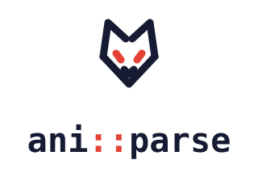

<div align="center">

<picture>
  <source media="(prefers-color-scheme: dark)" srcset="assets/lockup-dark.svg">
  
</picture>

**Единый асинхронный C++20 API для источников аниме, манги и изображений**


[](https://github.com/AnAgTeam/aniparse/actions/workflows/coverage.yml)
[](https://codecov.io/gh/AnAgTeam/aniparse)

[English](README.md) · **Русский**

</div>

> [!WARNING]
> Библиотека находится в ранней стадии разработки, API может существенно изменяться.

---

## Что такое AniParse?

**AniParse — C++20-библиотека с единым асинхронным API для источников аниме,
манги и изображений.** Она даёт приложениям для чтения, просмотра медиа и работы
с каталогами общий способ искать произведения, загружать метаданные, получать
страницы глав и находить источники видео — в пределах возможностей каждого источника.

Приложение работает с каталогами, профилями и геттерами. Реализация источника
переводит эти операции в свои HTTP-запросы и разбор HTML или JSON. Ядро
предоставляет интерфейсы, модели данных, выполнение запросов и общие средства
парсинга. По умолчанию собирается статическая библиотека; доступна и динамическая сборка.

### Ядро и реализации источников

В этом репозитории находятся **библиотека**, общие движки и запускаемые примеры.
Конкретные источники подключаются отдельно.
[aniparse-parsers](https://github.com/AnAgTeam/aniparse-parsers) содержит реализации,
включая AniList и Kitsu: они предоставляют метаданные, но не страницы глав или видео.
Подключение одного ядра не регистрирует эти источники. Приложение выбирает,
какие реализации собирать и регистрировать.

**Оглавление**

- [Что такое AniParse?](#что-такое-aniparse)
- [Что можно построить на библиотеке](#что-можно-построить-на-библиотеке)
- [С чего начать](#с-чего-начать)
- [Дальнейшая работа с API](#дальнейшая-работа-с-api)
- [Требования](#требования)
- [Сборка](#сборка)
- [Установка](#установка)
- [Примеры](#примеры)
- [Структура проекта](#структура-проекта)
- [Вклад в проект](#вклад-в-проект)
- [Лицензия](#лицензия)

## Что можно построить на библиотеке

- **Просмотр и поиск по каталогам.** Типизированные описания фильтров, сортировка,
  автодополнение и пагинация по смещению элементов. Каталоги манги и аниме бывают
  раздельными и смешанными; карточка владеет геттером манги, аниме или обоими,
  если источник сам объединяет эти записи.
- **Загрузка данных и медиа.** Названия, обложки, сведения о публикации, главы
  и страницы, эпизоды и источники видео, а также необязательные комментарии,
  оценки, связи и рекомендации. Набор операций зависит от источника.
- **Открытие ссылок и восстановление сохранённых произведений.** Маршрутизация URL
  выбирает парсер и каталог; сериализация сохраняет данные для восстановления
  getter. Непрозрачные ID, внешние идентификаторы и связи между разными медиа
  помогают потребителю сохранять различия между произведениями.
- **Разделение профилей запросов и аккаунтов.** Каталог выбирает профиль настроек,
  зеркал и авторизации. Несколько каталогов могут использовать один профиль;
  потребитель явно выбирает нужный авторизованный контекст.
- **Выбор HTTP-бэкенда.** Curl и Apple NSURLSession реализуют общий интерфейс
  `HttpClient`. Coroutine-операции поддерживают отмену и возвращают ошибки через
  `Result<T>`; для реализации источников есть HTML/DOM, CSS-селекторы и JSON-хелперы.
- **Применение подписанных настроек источников.** `SourceOverrides` позволяет
  заменять объявленные домены, адреса профилей, селекторы и шаблоны без замены
  скомпилированного парсера. Изменение протокола или логики разбора требует
  обновления реализации.

Описания возможностей помогают выбирать доступные действия; потребитель всё равно
обрабатывает `NotImplemented` и ошибки запросов. Библиотека передаёт внешние ID
и связи, а решения о сопоставлении и объединении записей принимает приложение.
Планы и текущие границы возможностей собраны в [docs/TODO.md](docs/TODO.md).

## С чего начать

**Чтобы подключить готовые источники к приложению**, начните с
[aniparse-parsers](https://github.com/AnAgTeam/aniparse-parsers) и его
[сетевого примера](https://github.com/AnAgTeam/aniparse-parsers/blob/nightly/examples/example.cpp).
Выберите каталог, создайте контекст его профиля, затем выполняйте поиск
и загружайте данные через возвращённые геттеры.

Этот фрагмент выполняется внутри coroutine с результатом `RequestTask`.
`parser` — владеющий handle зарегистрированного источника, `catalog_id` взят
из его `catalogs()`, а `client` — HTTP-бэкенд. Пример выводит превью результатов
и загружает полное описание первой манги. Нужны `Parser.hpp` из
`aniparse/source/`, `CatalogRootGetter.hpp` из `aniparse/catalog/` и `<iostream>`.

```cpp
auto root = parser->make_catalog_getter(catalog_id);
if (!root) {
    co_return make_request_error(RequestErrorCode::InvalidArguments, "Unknown catalog");
}
auto profile = parser->make_profile(root->info().profile_id);
auto context = profile->make_context(client);

auto page = co_await root->search(context, {.query = "Frieren"}, {.limit = 10});
if (!page) co_return unexpected(std::move(page.error()));

for (auto& row : page->results) {
    if (auto preview = row.item.preview_info()) {
        std::cout << preview->title << '\n';
    }
    if (row.item.manga) {
        auto details = co_await row.item.manga->load_info(context);
        if (!details) co_return unexpected(std::move(details.error()));
        std::cout << details->common.description.text << '\n';
        break;
    }
}
```

Превью читается локально; `load_info()` может выполнять запрос. Каталог, профиль
и getter произведения живут до завершения вызванных coroutine-методов. У аниме
также есть `load_info()`; смешанный каталог не обязан возвращать мангу на каждой странице.

**Чтобы написать источник**, скопируйте [минимальный manga-парсер](examples/example_manga_parser.cpp)
и [геттер-фикстуру](examples/ExampleManga.hpp). Это офлайн-источник метаданных:
начните с объявления источника и контракта getter, затем добавляйте поддерживаемые
операции. Отдельные [примеры](examples/README.md) показывают вход, смешанные
каталоги, фильтры, связанные URL, разбор HTML и HTTP-запросы.

После установки [зависимостей](#требования) запустите минимальный пример из корня
репозитория (исполняемым примерам нужен C++23):

```sh
cmake -S . -B build -DANIPARSE_BUILD_EXAMPLES=ON -DANIPARSE_CURL_BACKEND=OFF
cmake --build build --target aniparse-example-manga-parser
./build/examples/aniparse-example-manga-parser
```

Генератор с несколькими конфигурациями может добавлять каталог вроде `Debug`
перед именем исполняемого файла. Пример не обращается к сети: выводит тестовое
произведение, восстанавливает его из сохранённых данных и проверяет конец списка.

## Дальнейшая работа с API

| Задача | Руководство |
|---|---|
| Разобраться в объектах и владении | [Архитектура](docs/architecture.md) |
| Выбрать каталог и обработать смешанные карточки | [Каталоги](docs/mixed-catalog.md) |
| Создать контекст, войти и сохранить авторизацию | [Профили запросов](docs/request-profiles.md) |
| Показать фильтры и проверить запрос | [Поиск](docs/search.md) |
| Реализовать источник | [Написание парсера](https://github.com/AnAgTeam/aniparse-parsers/blob/nightly/docs/WRITING-A-PARSER.md) |
| Найти публичные интерфейсы | [Главная страница API](docs/mainpage.md) |

## Требования

- **Компилятор:** с поддержкой C++20 (GCC 12+, Clang 15+, MSVC 2022+). Сами примеры и тесты собираются как C++23 (примеры используют `std::print`/`std::println`), поэтому для них нужен более новый компилятор и стандартная библиотека (ориентировочно GCC 14+, Clang 18+, MSVC 19.40+).
- **CMake:** 3.18+
- **vcpkg** (рекомендуется для управления зависимостями)

**Зависимости** (устанавливаются через vcpkg). Curl нужен только при `ANIPARSE_CURL_BACKEND=ON`; остальные пакеты ниже нужны ядру:

| Пакет | Назначение |
|---|---|
| `boost-json` | JSON-парсинг |
| `boost-regex` | Регулярные выражения |
| `curl` | Опциональный HTTP-бэкенд (через `libasyncnet`) |
| `fmt` | Форматирование строк |
| `tl-expected` | Обработка ошибок без исключений (`tl::expected`) |

Субмодули (подтягиваются автоматически):
- [lexbor](https://github.com/lexbor/lexbor) — HTML-парсер
- [libasyncnet](https://github.com/AnAgTeam/libasyncnet) — асинхронная сеть

---

## Сборка

### Клонирование

```bash
git clone --recurse-submodules https://github.com/AnAgTeam/aniparse
cd aniparse
```

### С vcpkg (рекомендуется)

```bash
cmake -B build \
  -DCMAKE_TOOLCHAIN_FILE=/path/to/vcpkg/scripts/buildsystems/vcpkg.cmake \
  -DCMAKE_BUILD_TYPE=Release
cmake --build build
```

### Без vcpkg

Убедитесь, что зависимости установлены в системе, затем:

```bash
cmake -B build -DCMAKE_BUILD_TYPE=Release
cmake --build build
```

### CMake-опции

| Опция | По умолчанию | Описание |
|---|---|---|
| `ANIPARSE_BUILD_TESTS` | `OFF` | Сборка тестов |
| `ANIPARSE_BUILD_EXAMPLES` | `OFF` | Сборка примеров |
| `ANIPARSE_CURL_BACKEND` | `ON` | Собрать curl-бэкенд (подтягивает `libasyncnet` + curl). Выключите, чтобы собрать ядро без транспорта и подставить свой бэкенд. |
| `ANIPARSE_NSURLSESSION_BACKEND` | `OFF` | Собрать бэкенд на NSURLSession (платформы Apple). |
| `ANIPARSE_SHARED` | `OFF` | Собрать динамическую библиотеку (`.dll` / `.so` / `.dylib`) вместо статической. Значение берётся из `BUILD_SHARED_LIBS`, если задан он. |

Динамическая сборка экспортирует все символы (разметки в заголовках не требуется) и
вбирает вендорные зависимости внутрь. Учтите: публичный API — это C++, через границу
библиотеки проходят `std::string`, шаблоны и исключения, поэтому потребитель должен
быть собран тем же компилятором и с той же конфигурацией рантайма. По умолчанию
остаётся статическая сборка — и для iOS верна именно она.

---

## Установка

```bash
cmake --install build --prefix /usr/local
```

После установки библиотека доступна через CMake:

```cmake
find_package(aniparse REQUIRED)
target_link_libraries(your_target PRIVATE aniparse::aniparse)
```

Или через pkg-config:

```bash
pkg-config --libs --cflags aniparse
```

---

## Примеры

Примеры находятся в директории [`examples/`](examples/). Для их сборки:

```bash
cmake -B build -DANIPARSE_BUILD_EXAMPLES=ON
cmake --build build
```

- [Минимальный manga-парсер](examples/example_manga_parser.cpp) + [геттер-фикстура](examples/ExampleManga.hpp) — шаблон источника метаданных, профиль по умолчанию, пагинация и восстановление.
- [Авторизация](examples/example_auth.cpp) — токен, отдельная конфигурация входа, принятие результата и сохранение сессии.
- [Смешанный каталог](examples/example_mixed_catalog.cpp) — манга, аниме, сгруппированные карточки и выбор превью.
- [Фильтры поиска](examples/example_search.cpp) — описание возможностей отдельно от значений, включение/исключение, проверка и пагинация.
- [Связанные произведения](examples/example_related.cpp) — маршрутизация ссылки с профилем каталога назначения и восстановление getter.
- [Парсинг](examples/example_parse.cpp) — извлечение данных из HTML: CSS-селекторы, DOM, JSON из `<script>`. Работает офлайн, на фикстуре.
- [Сеть](examples/example_net.cpp) — реальные HTTP-запросы через `request` / `request_html` / `request_json`.

**Настоящие, полноценные парсеры** — в отдельном репозитории [aniparse-parsers](https://github.com/AnAgTeam/aniparse-parsers): рабочие парсеры источников поверх официальных публичных API (AniList, Kitsu), демонстрирующие всю модель `Parser` / геттеров целиком — поиск, информацию, маршрутизацию URL и сериализацию на живых сервисах. Хороший ориентир для своего парсера.

---

Все примеры, кроме сетевого, работают офлайн. Команды запуска и порядок изучения
собраны в [руководстве по примерам](examples/README.md).

## Структура проекта

```
aniparse/
├── include/aniparse/       # Публичные заголовки
│   ├── catalog/            # Каталоги, поиск и пагинация
│   ├── source/             # Парсеры, профили и подписанные overrides
│   ├── runtime/            # Контексты запросов и общие сервисы
│   ├── net/                # HTTP-интерфейсы и опциональные бэкенды
│   ├── media/              # Общие модели и адаптеры ресурсов
│   ├── anime/              # Модели и геттеры аниме
│   ├── manga/              # Парсинг манги
│   ├── images/             # Парсинг изображений
│   ├── engines/            # Общие движки источников (напр. booru)
│   ├── html/               # HTML/DOM/JS парсер
│   └── utility/            # Вспомогательные утилиты
├── src/                    # Реализация
├── examples/               # Примеры использования
├── tests/                  # Тесты
├── lexbor/                 # Субмодуль: HTML-парсер
└── libasyncnet/            # Субмодуль: асинхронная сеть
```

---

## Вклад в проект

Pull request'ы и issue приветствуются. Убедитесь, что код компилируется без предупреждений (`-Wall -Wextra -Wpedantic`) и проходит тесты:

```bash
cmake -B build -DANIPARSE_BUILD_TESTS=ON
cmake --build build
ctest --test-dir build
```

---

## Лицензия

Распространяется под лицензией [MIT](LICENSE). Copyright © 2025–2026 Toilettrauma.

Обратите внимание: проект включает сторонние компоненты с собственными лицензиями — см. файл [NOTICE](NOTICE).
